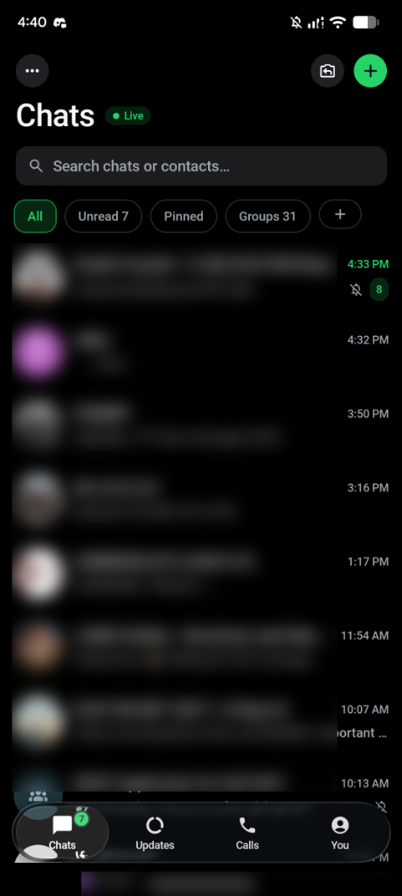
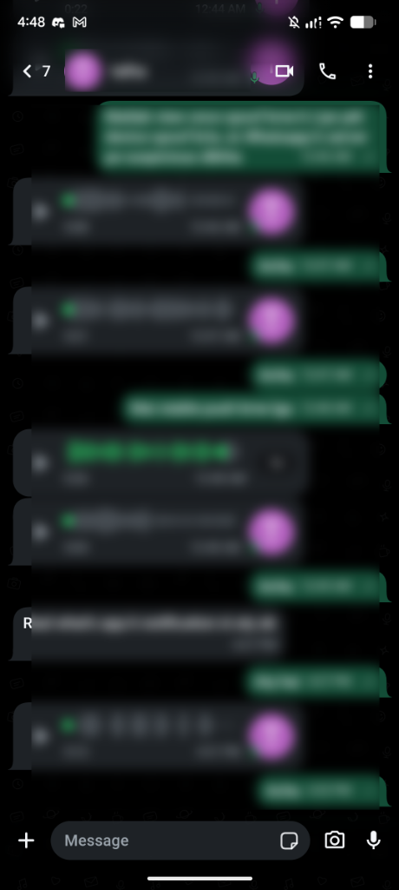
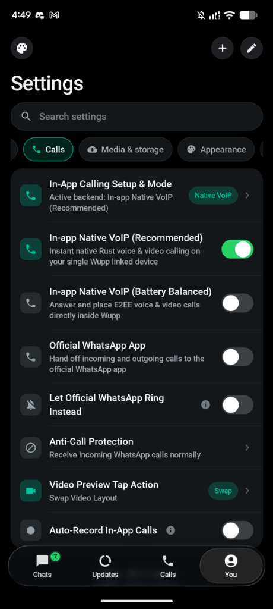

<div align="center">

<br/>


# Wupp

### A fast, privacy-first WhatsApp companion for Android — built with Jetpack Compose & Rust

<br/>

[](https://github.com/hanzalaramz/Wupp/releases/latest)
[](https://github.com/hanzalaramz/Wupp/releases)
[](https://github.com/hanzalaramz/Wupp/releases/latest)
[](https://github.com/hanzalaramz/Wupp/actions/workflows/ci.yml)
[](LICENSE)

<br/>

[**Download**](#download) · [**Screenshots**](#screenshots) · [**Features**](#features) · [**Privacy & Safety**](#privacy--safety) · [**FAQ**](#faq) · [**Build**](#for-developers)

</div>

> [!IMPORTANT]
> **Install Wupp alongside official WhatsApp — do not uninstall it.**
> Wupp connects as a **linked companion device**, not a standalone replacement. Keep official WhatsApp on your phone to verify your account, start brand-new chats with unknown numbers (Error 463 guard), and keep your 14-day linked session active.

---

<div align="center">

<h2><a id="screenshots"></a>Screenshots</h2>






</div>

---

<div align="center">

<h2><a id="features"></a>Features</h2>

<table>
  <tr>
    <td width="50%" valign="top">

#### Privacy & Ghost Mode
- **Ghost Mode** — freeze your last seen and stay hidden while online.
- **Hide Read, Played & Typing** — skip blue ticks, hide voice-note played status, and hide typing or recording indicators.
- **Per-Chat Privacy Overrides** — customize read, played, typing, and Chat Privacy Mode (hide names & profile photos) for individual chats.
- **Anti-Delete & Edit History** — keep messages and statuses locally even if deleted, and tap edited messages to view past revisions.
- **App & Chat Lock** — protect the whole app or specific private chats on-device.

#### Calling & Media
- **Native E2EE Voice & Video Calls** — call directly inside Wupp over Rust VoIP with full-screen framing, Bluetooth/speaker routing, and a **draggable 4-corner self-preview**.
- **View-Once Unlocker & Sender** — open and save View-Once photos, videos, and voice notes locally (with a manual Download option or phone fallback), plus send View-Once media.
- **Multi-Media & HD Photos** — send up to 10 photos/videos at once with per-item captions, and keep Original-quality photos as real inline image bubbles.
- **Voice Notes** — Pause/Resume recording, View-Once voice notes, natural waveforms, background playback, and offline transcription.

    </td>
    <td width="50%" valign="top">

#### Design & Personalization
- **AMOLED & Translucent Glass UI** — pure black default theme with smooth borderless frosted headers, composer bar, and floating popups.
- **Home Layouts & Custom Nav Bar** — pick Classic, iOS-inspired, or Compact Home layouts, customize colors and density, and show or hide bottom navigation tabs.
- **Sticker Studio & Favorites** — create custom 512×512 stickers and keep favorited stickers saved locally so they never vanish.

#### Everyday Power Tools
- **Rich Group Tools** — `@` member autocomplete, `@everyone` Ghost Mentions, group member profile sheets, reaction counts, and admin-only group support.
- **Location, Contacts & QR** — interactive map cards with GPS/address sharing, native contact cards, and WhatsApp-style QR code share & scan.
- **Scheduled Messages & Drafts** — queue one-time or recurring messages, plus automatic per-chat drafts.
- **Multi-Account & In-App Updates** — switch between linked accounts, grab signed GitHub updates in place (or save APKs to `Downloads/Wupp`), and inspect local crash logs.

    </td>
  </tr>
</table>

</div>

---

<div align="center">

<h2><a id="download"></a>Download & Install</h2>

[](https://github.com/hanzalaramz/Wupp/releases/latest)
&nbsp;
[](https://apps.obtainium.imranr.dev/redirect?r=obtainium://add/https://github.com/hanzalaramz/Wupp)

<sub>Pick <code>Wupp-*-arm64-v8a.apk</code> for most modern Android phones, or <code>Wupp-*-universal.apk</code> for older 32-bit / x86 devices.</sub>

</div>

1. Keep **official WhatsApp** installed and signed in on your primary phone.
2. Download the latest APK from [Releases](https://github.com/hanzalaramz/Wupp/releases/latest) (Android 8.0+) and install it.
3. Grant notification, media, and background permissions on the setup screen.
4. Link Wupp from **Linked devices** in official WhatsApp using a QR code or phone-number link code.

Future updates prompt inside Wupp and install in place without logging you out.

---

## <a id="privacy--safety"></a>Privacy & Safety

Wupp sends **zero analytics, telemetry, or crash reports** to any developer server. Chats, media, keys, and settings stay on your phone.

- **Direct WhatsApp traffic:** Messages, calls, media, statuses, and channels talk directly to WhatsApp servers through the native Rust bridge (`whatsapp-rust`).
- **GitHub API (optional):** Only used to check for new APK releases (`api.github.com/repos/hanzalaramz/Wupp/releases`) or open a pre-filled bug/feature form in your browser when you tap it.
- **Built-in rate-limit & session safeguards:** Global sync cooldowns, batched avatar lookups with miss caching, automatic `429` backoff, Error 463 unknown-number protection, and a 14-day primary-phone heartbeat tracker.

[](ARCHITECTURE.md)

---

## <a id="faq"></a>FAQ

<details>
<summary><b>Do I need to uninstall official WhatsApp?</b></summary>
<br/>
No — keep it installed. Wupp works as a linked companion device, so your primary WhatsApp app keeps your account verified and refreshes the 14-day linked-device window.
</details>

<details>
<summary><b>Why does Wupp warn before messaging a brand-new unknown number?</b></summary>
<br/>
Sending a first message from a linked device to a number with zero chat history can trigger WhatsApp's Error 463 companion check. Wupp's guard warns you so you can start new unknown-number chats safely from your primary phone first.
</details>

<details>
<summary><b>How do I track updates in Obtainium?</b></summary>
<br/>
Tap the <b>Track Updates — Obtainium</b> button above, or add <code>https://github.com/hanzalaramz/Wupp</code> with asset filter <code>^Wupp-.*-arm64-v8a\.apk$</code> (turn on <i>Include prereleases</i> if you want beta builds).
</details>

<details>
<summary><b>Where do I report bugs or suggest features?</b></summary>
<br/>
In Wupp, open <b>Settings &gt; Updates &amp; GitHub Support</b> (or the top-right menu &gt; <b>Report bug / Feedback</b>). You can also use <a href="https://github.com/hanzalaramz/Wupp/issues">GitHub Issues</a> for bugs and <a href="https://github.com/hanzalaramz/Wupp/discussions">GitHub Discussions</a> for questions and ideas.
</details>

---

## <a id="for-developers"></a>For Developers

<details>
<summary><b>Build from source &amp; project layout</b></summary>

### Layout
- `app/` — Kotlin + Jetpack Compose Android client (`applicationId = "com.wupp.app"`, `minSdk = 26`, `targetSdk = 34`).
- `rustbridge/` — Rust JNI bridge wrapping [`whatsapp-rust`](https://github.com/oxidezap/whatsapp-rust), compiled into `app/src/main/jniLibs/<abi>/libwhatsbridge_rs.so`.

### Local Build
Requirements: Rust (`aarch64-linux-android` target), JDK 21, Gradle 9.6.1+, and Android SDK + NDK 27.

```bash
# 1. Build the native Rust bridge
bash rustbridge/build-android.sh   # Windows: .\rustbridge\build-android.ps1

# 2. Build the debug APK
gradle assembleDebug
```

### CI & Releases
- Pull requests run `.github/workflows/ci.yml` (Rust checks + unit tests + debug APK).
- Pushing a `v*` tag triggers `.github/workflows/release.yml`, publishing signed `Wupp-<tag>-arm64-v8a.apk`, `Wupp-<tag>-universal.apk`, and `SHA256SUMS.txt` (tags with `-` publish as pre-releases).

See [CONTRIBUTING.md](CONTRIBUTING.md), [CHANGELOG.md](CHANGELOG.md), and [SECURITY.md](SECURITY.md) for more details.

</details>

---

## Disclaimer

Wupp is an independent open-source project and is **not** affiliated with, sponsored by, or endorsed by WhatsApp LLC or Meta Platforms, Inc. Using unofficial companion clients or privacy modifications may violate WhatsApp's Terms of Service and could result in temporary or permanent account restrictions. Use at your own risk.

## Credits & License

- Built with [whatsapp-rust](https://github.com/oxidezap/whatsapp-rust), Jetpack Compose, Material 3, Room, Media3, and Coil.
- Released under the [MIT License](LICENSE).
