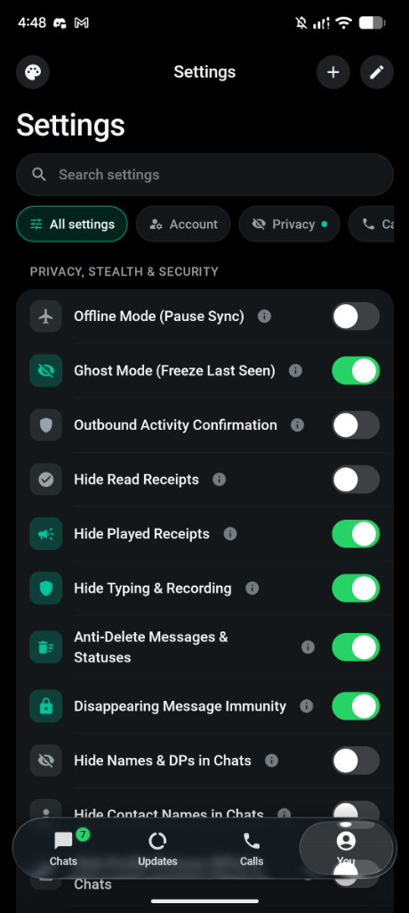

<div align="center">

<br/>


# Wupp

**A clean WhatsApp companion app for Android with privacy switches, AMOLED design, and native calls.**

<br/>

[](https://github.com/hanzalaramz/Wupp/releases/latest)
[](https://github.com/hanzalaramz/Wupp/releases)
[](https://github.com/hanzalaramz/Wupp/releases/latest)
[](LICENSE)

<br/>

[**Download**](#download) · [**Screenshots**](#screenshots) · [**Features**](#features) · [**FAQ**](#faq) · [**Build**](#for-developers)

</div>

> [!IMPORTANT]
> **Keep official WhatsApp installed.**
> Wupp links as a companion device, not a replacement. You still need the official app on your phone to verify your account, start chats with unknown numbers, and keep your 14-day linked session alive.

---

<div align="center">

<h2><a id="screenshots"></a>Screenshots</h2>





</div>

---

## <a id="features"></a>What You Get

### Privacy
- **Ghost Mode:** Freeze your last seen and stay hidden while online.
- **Hide Ticks & Typing:** Turn off read ticks, voice-note played ticks, and typing/recording status globally or per chat.
- **Keep Deleted Messages:** Save deleted messages, statuses, and edit history on your phone.
- **App & Chat Lock:** Lock the app or individual chats, and hide contact names and profile photos inside chats.

### Calls & Media
- **In-App Voice & Video Calls:** Native encrypted calls inside Wupp with a draggable corner self-preview.
- **View-Once Media:** Open, save, and send View-Once photos, videos, and voice notes.
- **Better Photos & Voice Notes:** Send up to 10 photos/videos at once with captions, pause/resume voice notes, and transcribe audio offline.

### Look & Feel
- **AMOLED & Glass UI:** Pure black default theme with smooth translucent bars and popups.
- **Custom Home Screen:** Pick Classic, iOS-style, or Compact layouts, change colors, and hide bottom tabs you don't use.
- **Stickers:** Create custom stickers in Sticker Studio and keep favorite stickers saved locally.

### Handy Extras
- **Better Groups:** `@` mention autocomplete, `@everyone` ghost mentions, member quick cards, and admin-only group support.
- **Locations, Contacts & QR:** Map preview cards, GPS sharing, native contact cards, and QR code scan/share.
- **Scheduled Messages & Drafts:** Schedule one-time or repeat messages and keep unsent drafts per chat.
- **Multi-Account & Easy Updates:** Switch between accounts and install signed updates right inside the app.

---

<div align="center">

<h2><a id="download"></a>Download</h2>

[](https://github.com/hanzalaramz/Wupp/releases/latest)
&nbsp;
[](https://apps.obtainium.imranr.dev/redirect?r=obtainium://add/https://github.com/hanzalaramz/Wupp)

<sub>Use <code>arm64-v8a</code> on most modern phones, or <code>universal</code> on older 32-bit / x86 devices.</sub>

</div>

1. Keep official WhatsApp installed and logged in on your phone.
2. Download and install the latest APK from [Releases](https://github.com/hanzalaramz/Wupp/releases/latest) (Android 8.0+).
3. Allow the setup permissions, then link Wupp from **Linked devices** in official WhatsApp using a QR code or phone link code.

Updates notify you inside Wupp and install over your existing app without logging you out.

---

## Privacy & Safety

Wupp has **no ads, no analytics, and no tracking**. Your chats, media, and keys stay on your phone.

- Messages, calls, and media go straight between your phone and WhatsApp servers via `whatsapp-rust`.
- Built-in cooldowns, rate-limit backoff, unknown-number send warnings, and a 14-day heartbeat reminder help keep your session healthy. See [ARCHITECTURE.md](ARCHITECTURE.md) for the technical details.
- GitHub is only contacted when checking for updates or when you choose to open a bug report.

---

## <a id="faq"></a>FAQ

<details>
<summary><b>Can I uninstall official WhatsApp after linking?</b></summary>
<br/>
No. Keep it installed so your account stays verified and your 14-day linked session doesn't expire.
</details>

<details>
<summary><b>Why does Wupp warn before messaging a new unknown number?</b></summary>
<br/>
Messaging a brand-new number with no prior history from a linked device can trigger WhatsApp's Error 463 check. Starting new unknown chats from official WhatsApp first is safer.
</details>

<details>
<summary><b>Where can I report bugs or suggest ideas?</b></summary>
<br/>
In Wupp, go to <b>Settings &gt; Updates &amp; GitHub Support</b> (or top-right menu &gt; <b>Report bug / Feedback</b>). You can also open a <a href="https://github.com/hanzalaramz/Wupp/issues">GitHub Issue</a> or post in <a href="https://github.com/hanzalaramz/Wupp/discussions">Discussions</a>.
</details>

---

## <a id="for-developers"></a>For Developers

<details>
<summary><b>Build from source</b></summary>

- `app/` holds the Kotlin + Jetpack Compose Android app (`com.wupp.app`, `minSdk 26`, `targetSdk 34`).
- `rustbridge/` holds the Rust JNI bridge built on [`whatsapp-rust`](https://github.com/oxidezap/whatsapp-rust).

Requires Rust (`aarch64-linux-android`), JDK 21, Gradle 9.6.1+, and Android SDK + NDK 27.

```bash
bash rustbridge/build-android.sh   # Windows: .\rustbridge\build-android.ps1
gradle assembleDebug
```

See [CONTRIBUTING.md](CONTRIBUTING.md), [CHANGELOG.md](CHANGELOG.md), and [SECURITY.md](SECURITY.md) for more.

</details>

---

## Disclaimer

Wupp is an independent open-source app and is not affiliated with or endorsed by WhatsApp LLC or Meta Platforms, Inc. Using unofficial companion clients may violate WhatsApp's Terms of Service and can risk account restrictions. Use it at your own risk.

## Credits & License

Built with [whatsapp-rust](https://github.com/oxidezap/whatsapp-rust), Jetpack Compose, Material 3, Room, Media3, and Coil. Licensed under the [MIT License](LICENSE).
